# Vision Action Platform

6일차에 학습한 Random Forest 동작 인식 모델(6개 Action)을 **다시 학습하지 않고** 재사용해, 브라우저에서 **영상 업로드** 또는 **IP Webcam**으로 AI 분석을 요청하고, 결과를 PostgreSQL에 저장하며, 관리자가 대시보드로 확인하는 웹 서비스입니다.

사용자는 분석 진행 단계(대기 → 처리 중 → 완료/실패)와 **영상 속 사람별(Track ID) 동작·Confidence·입력 품질**, 그리고 **그 영상에서 AI가 왜 그렇게 판단했는지(구간별 확률 그래프)**를 확인하고, 관리자는 Django Admin과 `/dashboard/` 차트로 전체 기록을 봅니다.

> 예측 Label은 정답이나 위험행동 판정이 아닙니다. 학습 데이터가 1명 × 6개 영상뿐이라, 확률이 낮거나 1·2등 차이가 작으면 **판단 보류**로 표시합니다.

---

## 1. 프로젝트 소개

| 항목 | 내용 |
|---|---|
| 해결하는 문제 | 1~8일차 Python 스크립트로만 돌던 동작 인식을, 로그인한 사용자가 웹에서 요청하고 결과가 DB에 남는 서비스로 만들기 |
| 입력 | ① MP4 영상 업로드 ② 허용된 IP Webcam에서 8초 수집 |
| 결과 | 작업 상태, 사람별 Track ID · 동작 · Confidence · 1·2등 차이 · 입력 품질, 최근 이력(접기/펴기), 상세 화면 |
| 판단 근거 | 지금 보는 영상의 지표 4개(1등 확률, 2등과 차이, 구간 일치율, 관절 인식 품질) + 그래프 2개(영상 구간별 동작 확률, 전체 구간 vs 구간 평균) |
| 관리자 | Django Admin(검색·필터), `/dashboard/`(동작별 예측 건수, 상태별 작업 건수 + 입력 방식별 처리 시간) |
| 구성 | Django·DRF · Celery Worker · Redis · FastAPI · PostgreSQL (Docker Compose 5개 서비스) |

## 2. 실행 방법

준비물: Docker Desktop(WSL2 연동), Git

```bash
git clone https://github.com/simpson92/vision_action_platform.git
cd vision_action_platform
cp .env.example .env          # 비밀번호·IP Webcam 주소 등 수정
```

모델 파일은 저장소에 포함돼 있습니다(`ai_service/models/`, 총 약 6.6MB). 서버가 시작할 때 `SHA256SUMS.txt`로 해시를 확인한 뒤에만 불러옵니다.

```text
ai_service/models/
├── rf_action_baseline.joblib   # 6일차 Random Forest (300 trees, 입력 1,140)
├── rf_feature_columns.json     # 1,140개 Feature 이름과 순서
├── rf_training_info.json       # 6 Class, 30 Step, min_valid_frames 10
├── yolo11n-pose.pt             # 6~8일차 YOLO Pose 가중치
└── SHA256SUMS.txt
```

```bash
docker compose up --build -d          # 5개 서비스 실행 (마이그레이션은 django 시작 시 자동)
docker compose ps                     # 모두 running/healthy 확인
docker compose exec django python manage.py createsuperuser   # .env에 DJANGO_SUPERUSER_* 를 채웠다면 생략
```

마이그레이션을 직접 하려면 `docker compose exec django python manage.py migrate`.

| 화면 | 주소 |
|---|---|
| 사용자 화면 (회원가입 → AI 분석) | http://localhost:8000/ |
| Django Admin | http://localhost:8000/admin/ |
| 관리자 대시보드 | http://localhost:8000/dashboard/ |
| FastAPI 문서 (개발·시연용) | http://localhost:8001/docs |

테스트:

```bash
docker compose exec django python manage.py test           # 웹·권한·Celery 저장 15개
docker compose exec fastapi python -m pytest -q tests      # AI 서버 7개 (테스트 영상이 있으면 실제 추론까지)
```

## 3. 전체 아키텍처

`compose.yaml`이 실행하는 서비스 5개(점선 박스)와 오가는 데이터입니다. 브라우저에 공개되는 것은 `django`(8000) 하나이고, 서비스끼리는 `localhost`가 아니라 서비스 이름(`fastapi`, `redis`, `postgres`)으로 통신합니다.

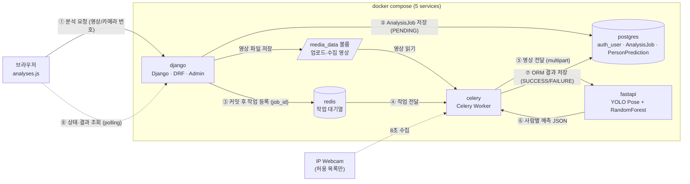

| 서비스 | 맡은 일 | 하지 않는 일 |
|---|---|---|
| django | 회원, 분석 요청 CRUD, 권한, 화면, Admin, 대시보드 집계 | AI 추론, 모델 학습 |
| celery | 영상 확보(업로드 파일 / IP Webcam 수집), FastAPI 호출, ORM 저장, 재시도 | 화면 렌더링 |
| redis | Celery 메시지 브로커 | 업무 데이터 영구 저장 |
| fastapi | 영상 → Pose·Tracking → Feature → Random Forest → JSON | DB 테이블·ORM·회원 관리 |
| postgres | 사용자·작업·사람별 예측 영구 저장 (`postgres_data` 볼륨) | — |

## 4. DB 설계 (ERD)

직접 작성한 모델: [`backend/analyses/models.py`](backend/analyses/models.py) (`auth_user`는 Django 기본 제공)

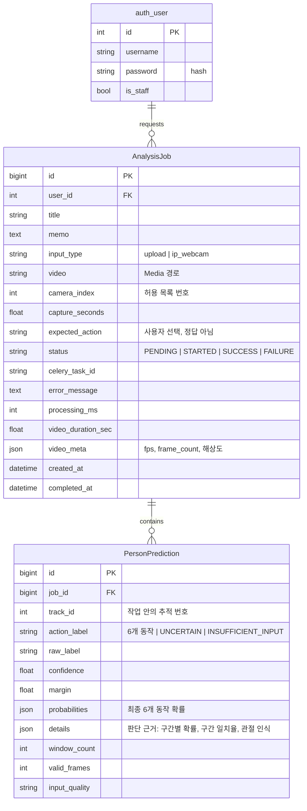

| 테이블 | 저장하는 것 |
|---|---|
| `auth_user` | 회원(아이디, 비밀번호 해시, 관리자 여부) |
| `AnalysisJob` | 분석 요청 1건: 누가, 어떤 입력으로, 지금 상태, 오류 사유, 처리 시간 |
| `PersonPrediction` | 한 작업 안의 사람 1명의 예측. 두 사람이 나오면 작업 1건에 2행. `(job, track_id)` 유일. 화면 그래프에 쓰는 판단 근거(`details`)도 함께 저장 |

- 영상 파일 자체는 DB가 아니라 Media 볼륨에 두고 경로만 저장합니다.
- IP Webcam 주소는 DB·화면에 남기지 않고 허용 목록 번호(`camera_index`)만 저장합니다.
- 작업을 삭제하면 사람별 예측은 `CASCADE`로 함께 지우고 영상 파일도 지웁니다. 처리 중(STARTED)인 작업은 삭제할 수 없습니다.

## 5. AI 추론 버튼 구현 흐름

사용자가 **AI 분석 시작** 버튼을 한 번 누르면 일어나는 일과 각 단계를 맡은 파일입니다.

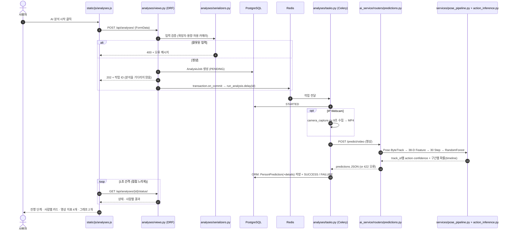

상단 지표와 그래프는 **누적 통계가 아니라 지금 보는 영상 한 건**의 값입니다. 이력 표에서 다른 행을 누르면 그 영상의 결과로 바뀌고, 한 영상에 사람이 여럿이면 사람 카드를 눌러 바꿉니다. 전체 누적 통계는 관리자 대시보드에서만 봅니다.

## 6. 사용한 모델과 입력 형식

| 항목 | 내용 |
|---|---|
| 동작 분류 모델 | `rf_action_baseline.joblib` (6일차 Random Forest, 300 trees, S01 6 clip 학습) |
| 입력 Feature | 30 Step × 38 Feature = 1,140 (정규화 좌표 34 + 팔꿈치·무릎 각도 4) |
| Pose | `yolo11n-pose.pt` (COCO 17 Keypoint), image_size 640, person_conf 0.25, ByteTrack |
| 지원 동작 | `bend_return`, `leg_raise_lower`, `walk_turn_walk`, `drink_return`, `sit_stand`, `wave` |
| 업로드 형식 | MP4 등 영상, 최대 50MB. 전신이 보이는 3~10초 영상 권장 |
| IP Webcam | `.env`의 `IP_WEBCAM_ALLOWED_URLS`에 등록한 카메라만, **8초** 수집 |

**FastAPI API 계약**

| 엔드포인트 | 입력 | 반환 |
|---|---|---|
| `GET /health` | 없음 | 서버 상태, 모델 준비 여부, Class 6개, Feature 1,140 |
| `POST /predict/video` | multipart `file` (영상) | `status`(ok/no_person), 영상 정보, `predictions[]`, `processing_ms` |

```json
{
  "status": "ok",
  "video": {"filename": "S03_A001_T01.mp4", "fps": 25.0, "frame_count": 62, "duration_sec": 2.48},
  "predictions": [
    {"track_id": 1, "action_label": "bend_return", "raw_label": "bend_return",
     "confidence": 0.25, "margin": 0.057, "window_count": 1, "window_agreement": 1.0,
     "valid_frames": 62, "detected_frames": 62, "interpolated_joints": 0, "mean_keypoint_conf": 0.95,
     "input_quality": "good", "probabilities": {"bend_return": 0.25, "leg_raise_lower": 0.193, "...": 0},
     "whole_probabilities": {"...": 0}, "window_mean_probabilities": {"...": 0},
     "timeline": [{"start_sec": 0.0, "end_sec": 2.44, "label": "bend_return", "probabilities": {"...": 0}}]}
  ],
  "processing_ms": 3100
}
```

- 읽을 수 없는 영상 → `422` + 사유 / 지원하지 않는 형식·빈 파일 → `400` / 모델 미준비 → `503`
- 영상은 정상인데 사람이 없음 → `200`, `status: "no_person"`, 빈 `predictions`
- `timeline`은 2초 구간(0.5초씩 이동)마다의 확률, `window_agreement`는 그 구간들 중 최종 1등과 같은 답을 낸 비율입니다. 화면의 "구간 일치율"과 그래프가 이 값을 씁니다.
- Celery는 422·400은 바로 **FAILURE**, 503·타임아웃·연결 실패는 **2번 재시도** 후 FAILURE로 저장합니다.

## 7. 실행 결과와 검증

### 모델 재사용 검증 (5일차 영상 12개)

`ai_service/scripts/evaluate_videos.py`로 S02(검증용 사람)·S03(테스트용 사람) 영상을 서비스와 같은 코드로 분석했습니다. 결과 원본: [`docs/evaluation_S02_S03.txt`](docs/evaluation_S02_S03.txt)

| 방식 | S02 Top-1 | S03 Top-1 | 판단 확정한 결과의 정답률 |
|---|---|---|---|
| 6일차 그대로 (전체 구간 1회, 기준 0.55) | 2/6 | 6/6 | 0건 확정 (전부 UNKNOWN) |
| **이 서비스** (전체 구간 + 2초 Window 평균, margin 기준) | **4/6** | 5/6 | **5건 확정, 5건 정답** |

- 방식과 기준값은 **S02로만** 골랐고 S03은 마지막 확인에만 썼습니다(테스트 데이터로 튜닝하지 않음).
- 오답은 모두 1·2등 차이가 작아 "판단 보류"로 표시됐습니다. 확정한 결과는 모두 맞았습니다.
- 좌우 반전 예측 평균, 구간 길이 섞기, fps 영향도 같은 방법(S02로만 비교)으로 시험했지만 분명히 좋아지지 않아 반영하지 않았습니다: [`docs/inference_experiments.md`](docs/inference_experiments.md)

> 아래 캡처는 시연 PC(Windows + WSL2 Docker)에서 5개 서비스를 띄우고 찍은 화면입니다. "판단 보류" 화면만 같은 코드로 개발 환경에서 찍었습니다.

### 정상 분석

입력: `S03_A006_T01.mp4`(손 흔들기) → 사람 #1 **손 흔들기**, Confidence 33.0%(무작위 16.7%의 2.0배), 2등과 차이 14.1%p, 2초 구간 6개 모두 같은 답(구간 일치율 100%), 관절 인식 0.97, AI 처리 4.0초

### 판단 보류 (AI가 답을 미룬 경우)
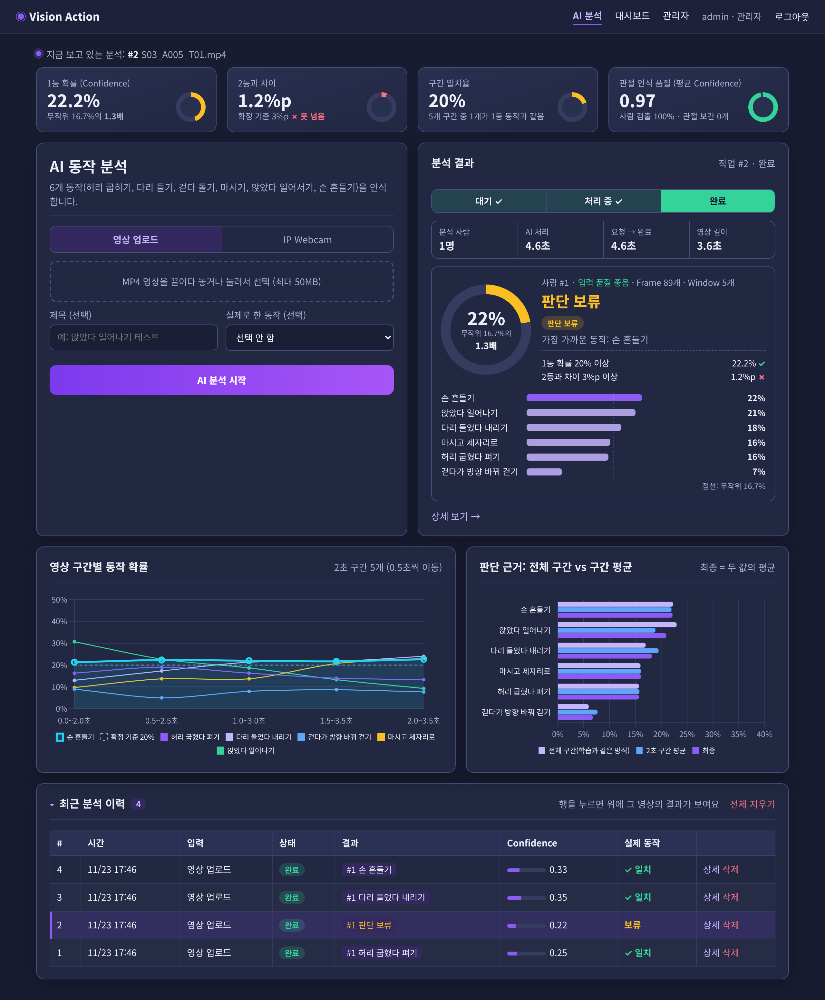
입력: `S03_A005_T01.mp4`(앉았다 일어나기) → 1등 손 흔들기 22.2%와 2등 앉았다 일어나기 21%의 차이가 1.2%p라 기준(3%p)에 못 미쳐 **판단 보류**. 구간별 그래프에서 두 동작이 구간마다 엎치락뒤치락하는 것이 보입니다. 틀린 답을 확정하는 대신 보류합니다.

### 최근 분석 이력 · 두 사람이 보이는 영상 (T04)
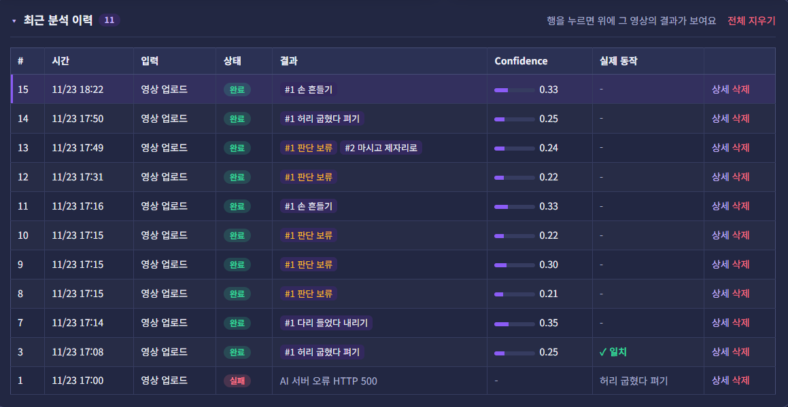
행을 누르면 위 지표·그래프가 그 영상으로 바뀝니다. #13은 한 영상에 두 사람이 잡혀 결과가 2건(#1 판단 보류, #2 마시고 제자리로)으로 저장됐습니다. #1은 실패한 작업이 사유와 함께 남은 예입니다. 제목을 누르면 표를 접을 수 있습니다.

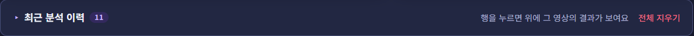

### 오류·실패
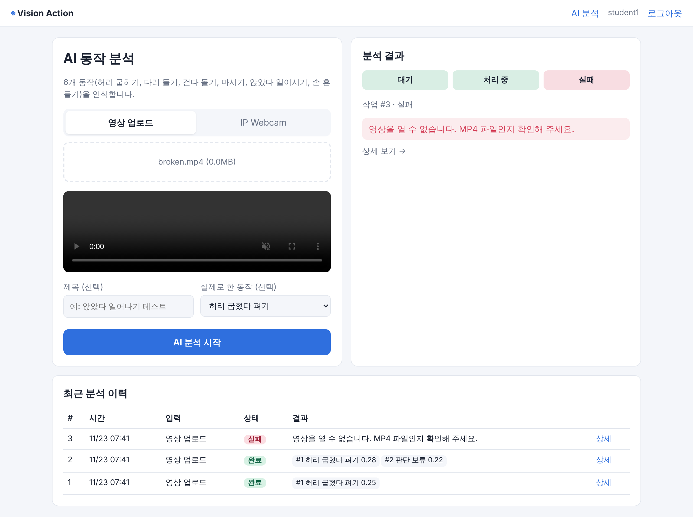
입력: 확장자만 .mp4인 텍스트 파일 → 결과: 실패, "영상을 열 수 없습니다. MP4 파일인지 확인해 주세요." (이전 디자인 캡처)
IP Webcam이 꺼져 있을 때 → 실패, "카메라에 연결하지 못했습니다. 휴대폰 IP Webcam 앱이 켜져 있고 같은 Wi-Fi인지 확인해 주세요." ([캡처](docs/images/ipwebcam_fail.png))

### 관리자 대시보드
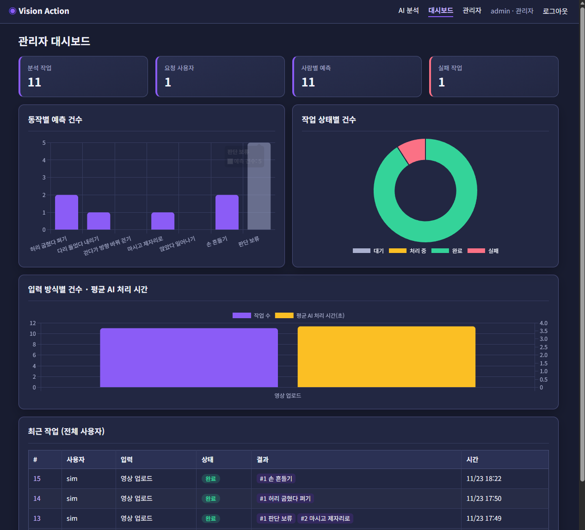
관리자 계정으로 `/dashboard/`: 전체 사용자의 누적 통계. 동작별 예측 건수(막대), 작업 상태별 건수(도넛), 입력 방식별 건수·평균 AI 처리 시간

### Django Admin · 권한
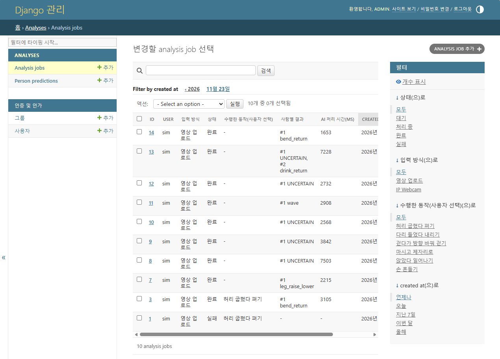
분석 작업 목록: 사용자·입력 방식·상태·사람별 결과·AI 처리 시간, 상태·입력 방식·동작·날짜 필터

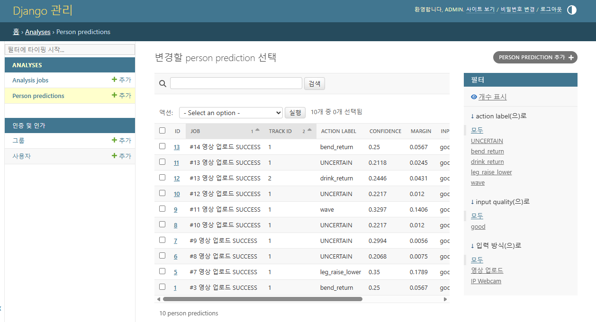
사람별 예측: 작업·Track ID·동작·Confidence·margin·입력 품질

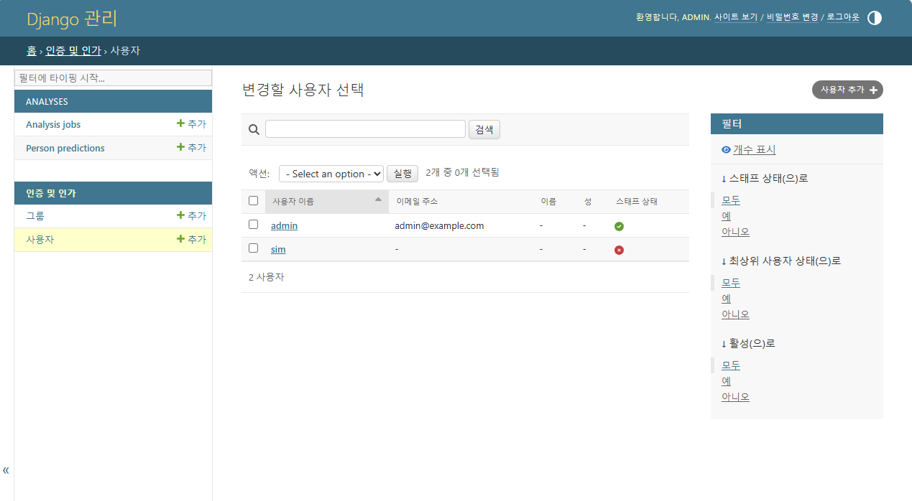
사용자: 관리자(`admin`, 스태프)와 일반 회원(`sim`)

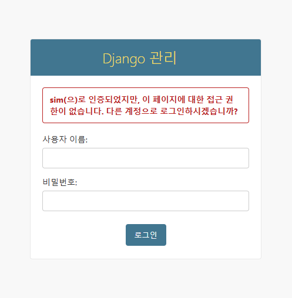
일반 회원(`sim`)이 `/admin/`에 들어가면 접근 권한이 없다고 막힙니다.

### DRF API
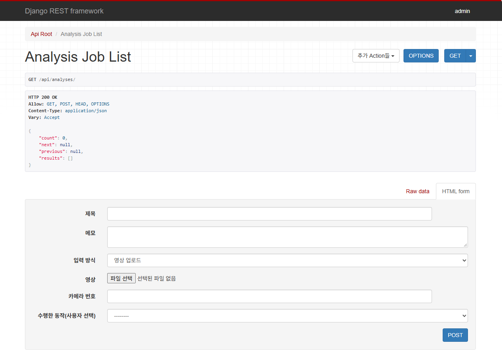
`/api/analyses/`: 로그인한 사용자 **본인의 작업만** 보입니다. 캡처는 `admin`으로 연 화면이라 0건이고(분석은 `sim`이 함), 관리자는 `?all=1`로 전체를 봅니다. 같은 주소로 분석을 등록(POST)할 수도 있습니다.

### 기능 테스트 (과제 11장)

| 테스트 | 확인 방법 | 결과 |
|---|---|---|
| T01 모델 불러오기 | `GET /health`, `test_health_model_ready` | 6 Class · 1,140 Feature |
| T02 영상 업로드 | S03 영상 업로드 | 작업 등록 → 사람별 결과 |
| T03 IP Webcam | 휴대폰 IP Webcam 8초 | <!-- 시연 후 기록 --> |
| T04 사람별 결과 | S02_A001 영상(뒤에 사람 1명 더) | Track ID 2개로 분리 저장 |
| T05 비동기 | `test_create_returns_job_id_immediately` | 202 + 작업 ID 즉시 반환 |
| T06 영구 저장 | `test_task_saves_predictions`, 새로고침 | DB에 작업·예측 유지 |
| T07 CRUD 권한 | `test_user_cannot_touch_others_job` | 남의 작업 조회·수정·삭제 404 |
| T08 관리자 | `test_dashboard_admin_only` | 관리자만 대시보드·전체 목록 |
| T09 예외 처리 | 잘못된 파일 업로드, 꺼진 카메라 / `test_task_failure_is_saved` | FAILURE + 사용자용 사유 저장 |
| T10 Docker | `docker compose restart` 후 재조회 | <!-- 시연 후 기록 --> |

## 8. 교재와 다르게 구현한 점과 이유

| 항목 | 교재·6~8일차 | 이 서비스 | 이유 |
|---|---|---|---|
| 판단 보류 기준 | 확률 0.55 미만이면 UNKNOWN | 확률 0.20 미만 **또는 1·2등 차이 0.03 미만**이면 판단 보류 | 6 clip으로 학습한 RF는 확률이 0.2~0.3대라 0.55면 7일차처럼 전부 UNKNOWN. S02로 기준을 다시 맞춤 |
| 예측 안정화 | 최근 5개 예측 다수결 | 전체 구간 확률 + 2초 Window 확률 평균을 반씩 | 다수결은 확률 정보를 버림. S02 Top-1 2/6 → 4/6 |
| 결측 관절 | 그대로 사용 | Confidence 0.3 미만 관절을 같은 사람의 앞뒤 Frame으로 보간 | 순간적으로 튀는 관절 값 완화 (Puchała 외, 2023) |
| 모델 파일 로드 | `joblib.load()` 바로 호출 | SHA256 해시 확인 후 로드 | `joblib.load`는 pickle 실행 → 우리 파일인지 확인 |
| 입력 품질 | 없음 | 검출 Frame 비율·관절 Confidence로 좋음/보통/나쁨 표시 | 과제 문서: "Confidence와 입력 품질을 함께 표시" |
| 카메라 주소 | 사용자 입력 | `.env` 허용 목록에서 번호로만 선택 | 임의 URL 호출(SSRF) 방지, 접속정보 비노출 |
| 결과 화면 | 동작 이름과 확률 | 영상 한 건의 판단 근거(구간별 확률 그래프, 구간 일치율, 관절 인식 품질)를 함께 표시 | 확률이 낮은 모델이라 숫자 하나보다 "왜 이 답인지, 왜 보류했는지"를 보여 주는 게 더 정직함 |

참고 논문
- Nunes, Faria, Peixoto (2017). *Pattern Recognition Letters* — 스켈레톤 Feature + Random Forest
- Puchała, Kasprzak, Piwowarski (2023). *Sensors* 23(14) — 포즈 Tracking + 슬라이딩 Window, 결측 관절 보정
- Yan, Xiong, Lin (2018). *AAAI* — ST-GCN (데이터가 늘면 FastAPI 서버만 교체하는 확장 방향)

## 9. 문제 해결 기록

**1) 7일차처럼 모든 결과가 UNKNOWN**
- 보인 문제: 정답 동작이 1등인데도 확률 0.25라 기준 0.55에 걸려 전부 UNKNOWN
- 확인한 곳: `reports/day07/runtime_comparison.md`(평균 Confidence 0.23), S02 영상 6개의 확률 분포
- 바꾼 것: 1등 확률만 보지 않고 1·2등 차이(margin)를 함께 보도록 `action_inference.py` 수정, 기준은 S02로 선택
- 확인: S02·S03에서 확정한 5건 모두 정답, 틀린 건 모두 판단 보류

**2) 6일차 Test 6/6인데 서비스에서는 4/6**
- 보인 문제: 같은 S03 영상인데 정확도가 떨어짐
- 확인한 곳: 학습 스크립트 `34_build_sequence_dataset.py` — Clip 전체를 30 Step으로 리샘플링
- 원인: 긴 영상(5초 초과)은 Window로만 예측해 학습 때와 입력 구간이 달랐음
- 바꾼 것: 학습과 같은 "전체 구간" 예측을 항상 포함하고 Window 평균과 섞음 → S03 5/6, S02 4/6

**3) 원본 `src/common.py`가 설정 파일을 못 찾음**
- 원본은 `configs/project.json`, 새 구조는 `ai_service/project.json` → `CONFIG_PATH` 수정

**4) Tracking 시 `ModuleNotFoundError: lap` / Celery 시작 시 `No module named 'packaging'`**
- `model.track()`(ByteTrack)에 필요한 `lap`, kombu Redis 전송 모듈이 쓰는 `packaging`을 각각 `requirements.txt`에 고정

**5) 대시보드 차트가 인터넷 없는 곳에서 안 보임**
- Chart.js를 CDN 대신 `backend/static/vendor/`에 포함(MIT 라이선스 동봉)

**6) Docker에서 fastapi만 계속 재시작 (`ImportError: libxcb.so.1`)**
- 확인한 곳: `docker compose logs fastapi` → `import cv2`에서 실패
- 원인: `ultralytics`가 의존성으로 화면용 `opencv-python`을 설치해 `opencv-python-headless`를 덮어씀. slim 이미지에는 화면 라이브러리(libxcb·libGL)가 없음
- 바꾼 것: `ai_service/Dockerfile`에서 두 opencv를 지우고 headless판만 다시 설치 (apt로 화면 라이브러리를 까는 것보다 이미지가 작음)

**7) Docker에서 분석 요청 시 `AI 서버 오류 HTTP 500` (`operator torchvision::nms does not exist`)**
- 확인한 곳: `docker compose logs fastapi` → YOLO warmup 중 `import torchvision`에서 실패
- 원인: torch는 CPU 전용 저장소에서, torchvision은 ultralytics 의존성으로 PyPI에서 따로 설치돼 서로 다른 torch 판으로 빌드된 짝이 됨
- 바꾼 것: Dockerfile에서 torch와 torchvision을 같은 CPU 저장소에서 함께 설치

## 폴더 구조

```text
vision_action_platform/
├── backend/                 # Django·DRF + Celery Worker (같은 이미지)
│   ├── config/              # settings, urls, celery
│   ├── accounts/            # 회원가입·로그인·로그아웃
│   ├── analyses/            # models, serializers, views(API), page_views(화면·대시보드), tasks, services, camera_capture, admin, tests
│   ├── templates/  static/
│   ├── Dockerfile  entrypoint.sh  requirements.txt
├── ai_service/              # FastAPI 추론 서버
│   ├── main.py  settings.py  schemas.py
│   ├── routers/predictions.py
│   ├── services/            # model_loader, pose_pipeline, action_inference
│   ├── src/                 # 6~8일차 원본 모듈 (common.py 경로만 수정)
│   ├── models/              # joblib · JSON · YOLO Pose · SHA256SUMS
│   ├── scripts/             # evaluate_videos(정확도 평가), experiment_inference(추론 방식 실험)
│   ├── tests/
│   ├── Dockerfile  requirements.txt
├── compose.yaml  .env.example  docs/
```
