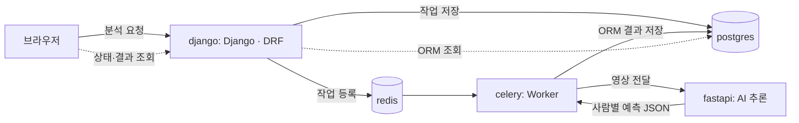
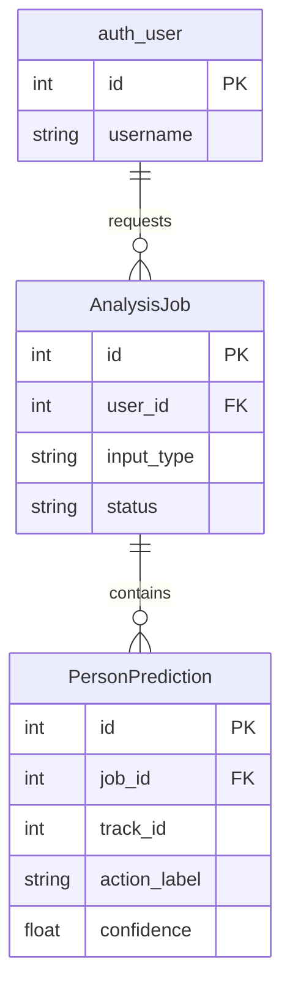

# Vision Action Platform

6일차에 학습한 Random Forest 동작 인식 모델(6개 Action)을 재사용해, 브라우저에서 영상 업로드 또는 IP Webcam으로 AI 분석을 요청하고 결과를 저장·조회하는 웹 서비스입니다.

> 예측 Label은 정답이나 위험행동 판정이 아닙니다. Confidence와 입력 품질을 함께 확인하세요.

---

## 1. 프로젝트 소개

<!-- TODO: 어떤 문제를 해결하는 서비스인지 2~3문장 -->

- 지원 입력: 영상 업로드(MP4), IP Webcam(짧은 구간 수집)
- 사용자가 확인하는 결과: 작업 상태, 사람별 Track ID · Action · Confidence, 최근 분석 이력
- 관리자: Django Admin, `/dashboard/` 차트 2개

## 2. 실행 방법

```bash
# 1) 환경변수 준비
cp .env.example .env        # 값 수정

# 2) 모델 파일 위치 확인
#    ai_service/models/rf_action_baseline.joblib
#    ai_service/models/rf_feature_columns.json
#    ai_service/models/rf_training_info.json

# 3) 실행
docker compose up --build

# 4) 마이그레이션 · 관리자 계정
docker compose exec django python manage.py migrate
docker compose exec django python manage.py createsuperuser
```

| 화면 | 주소 |
|---|---|
| 사용자 화면 | http://localhost:8000/ <!-- TODO --> |
| Django Admin | http://localhost:8000/admin/ |
| 관리자 대시보드 | http://localhost:8000/dashboard/ |
| FastAPI 문서(개발용) | http://localhost:8001/docs <!-- TODO: 포트 공개 여부 --> |

## 3. 전체 아키텍처

<!-- TODO: compose.yaml의 5개 서비스, 화살표에 오가는 것(분석 요청, 작업 등록, 영상 전달, 결과 저장) 표시 -->



## 4. DB 설계 (ERD)

직접 작성한 모델: `backend/analyses/models.py`



<!-- TODO: 실제 필드로 갱신, 테이블별 한 줄 설명 -->

## 5. AI 추```mermaid
sequenceDiagram
    participant JS as analyses.js
    participant V as views.py (DRF)
    participant S as serializers.py
    participant DB as PostgreSQL
    participant R as Redis
    participant T as tasks.py (Celery)
    participant F as predictions.py (FastAPI)
    participant M as action_inference.py
    JS->>V: POST /api/analyses/ (영상 또는 카메라)
    V->>S: 입력 검증
    alt 잘못된 입력
        S-->>JS: 400 오류 응답
    else 정상 입력
        V->>DB: AnalysisJob 생성 (PENDING)
        V->>R: 커밋 후 task.delay(job_id)
        V-->>JS: 작업 ID 반환
    end
    R->>T: 작업 수신 (STARTED)
    T->>F: POST /predict/video (HTTP)
    F->>F: Pydantic·영상 입력 검증
    F->>M: Pose → Feature → RandomForest
    M-->>F: track_id별 action·confidence
    F-->>T: predictions JSON
    T->>DB: ORM으로 상태(SUCCESS/FAILURE)·PersonPrediction 저장
    loop 완료될 때까지
        JS->>V: GET /api/analyses/{id}/status/
        V->>DB: ORM 조회
        V-->>JS: 상태·사람별 결과
    end
```: GET /api/analyses/{id}/status/
    end
```

## 6. 사용한 모델과 입력 형식

| 항목 | 내용 |
|---|---|
| 동작 분류 모델 | `rf_action_baseline.joblib` (Random Forest, 6일차) |
| Feature | 30 Step × 38 Feature = 1,140 (`rf_feature_columns.json`) |
| Pose 모델 | `yolo11n-pose.pt` (COCO 17 Keypoint) |
| 지원 동작 | bend_return, leg_raise_lower, walk_turn_walk, drink_return, sit_stand, wave |
| 업로드 형식 | MP4 <!-- TODO: 길이·용량 제한 --> |
| IP Webcam 수집 시간 | 8초 <!-- TODO --> |

<!-- TODO: FastAPI 입력과 반환 JSON 예시 -->

## 7. 실행 결과와 검증

### 정상 분석
<!-- 캡처 + 입력과 결과 한 줄 -->

### 오류·실패
<!-- 캡처 + 입력과 메시지 한 줄 -->

### 관리자 화면 · 대시보드
<!-- 캡처 -->

### 문제 해결 기록
<!-- 문제 → 확인한 곳 → 바꾼 것 → 해결 확인 -->
